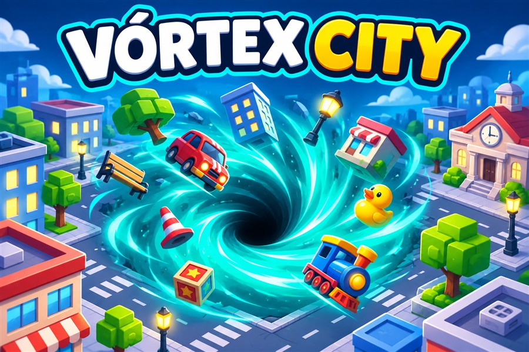

# Vórtex City

Jogo original inspirado na mecânica de buracos que engolem objetos. Cidade 3D, seis participantes (um jogador e cinco adversários do computador), crescimento progressivo, boost com energia, partidas de dois minutos e recorde local.

Controlos: WASD ou setas, rato com botão premido, ou toque/arrastar. Espaço, Shift ou botão BOOST para acelerar. Escape ou botão de pausa. A perda de foco pausa a partida.

Sem anúncios, contas, compras ou dependências remotas. As pontuações e a cor são guardadas no navegador quando disponível. Geometrias e interface próprias. Three.js incluído localmente, licença MIT em dist/vendor/LICENSE.txt.

Executar: `npm run dev` e abrir http://127.0.0.1:8790/. Testes: `npm test`.

## Cidade ampliada e física

Mapa de 160 x 160 unidades, com 36 quarteirões e 628 objetos. Os objetos mantêm o tamanho, inclinam, são atraídos e caem com aceleração gravitacional; o plano do chão recorta a parte submersa. Carros e objetos de rua ainda demasiado grandes podem deslizar ao tocar no buraco. É uma simulação arcade, sem colisões completas entre todos os objetos. Fachadas usam instâncias e os objetos distantes deixam de ser desenhados.

## Orientação e estabilidade

Minimapa com rivais, jogador e objetos elegíveis. Boost com recarga mínima de 30% após esgotar para evitar arranques repetidos. Simulação dividida em passos de até 1/60 s, IA acompanha posições físicas e limites são reaplicados após crescimento. O relógio avisa nos últimos 20 segundos.

## Estilo urbano

Fachadas com janelas nas quatro faces, montras, toldos e equipamentos de cobertura; torres entre 13 e 21 unidades de altura. Passeios com juntas e estradas com linhas duplas interrompidas nos cruzamentos. Indicadores de nível e progresso por buraco, câmara com afastamento progressivo e transparência nos edifícios que ocultam o jogador.

## Bairros e exploração

36 quarteirões distribuídos por cinco zonas: Parque Central, Bairro dos Jardins, Centro Financeiro, Praça do Mercado e Cais da Cidade. Parques com fontes consumíveis e caminhos cruzados, casas com jardins, torres agrupadas, mercados com quatro bancas e cais com armazéns e pontões decorativos. O minimapa distingue as zonas por cor e o HUD mostra o bairro atual. Cada ponto inicial tem pelo menos 12 objetos consumíveis próximos.

## Publicação e app

[Jogar agora](https://vortex-city-master171.master-171.chatgpt.site/) · [Código no GitHub](https://github.com/Master-Devs171/dinoplay-vortex-city)

Pacote DinoPlay: manifest.json aponta para dist/index.html. Inclui o SDK local, guarda progresso através da app quando integrado e permite voltar à biblioteca. Fora da app funciona sem login e guarda o progresso neste dispositivo. Idioma atual: português. Todos os recursos de execução são locais; sem anúncios, pagamentos ou serviços externos.

Validação: node scripts/validate.mjs. Desenvolvimento: npm run dev. Testes: npm test.
